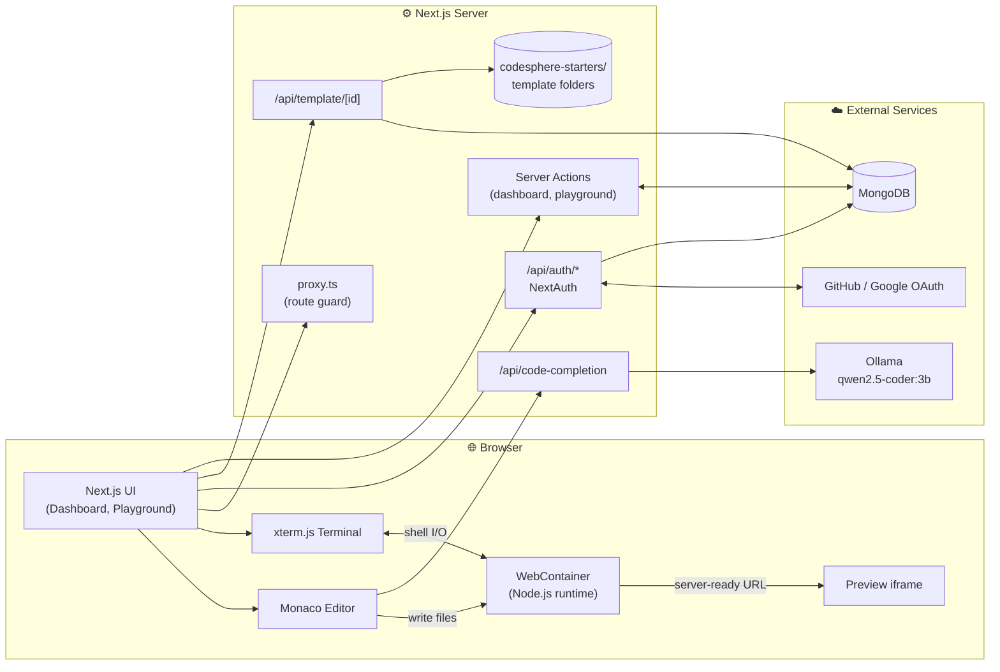
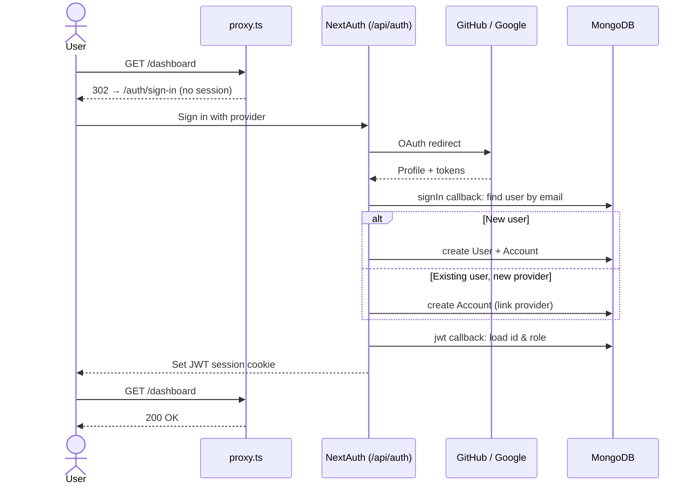
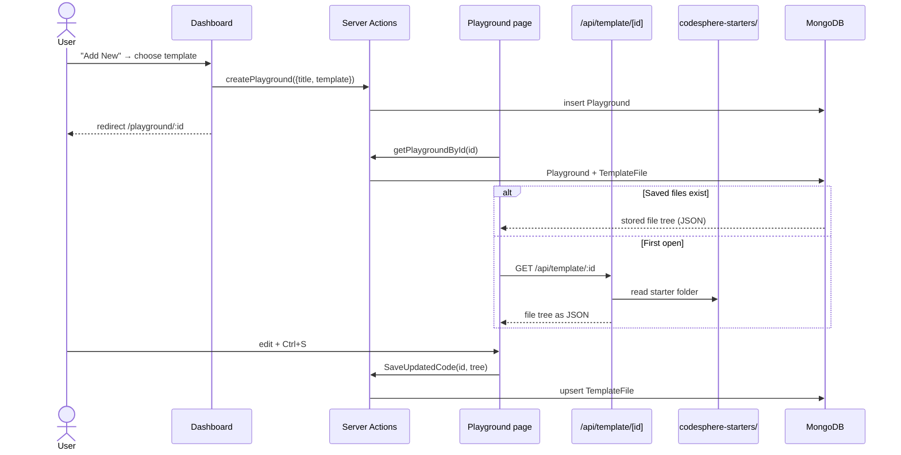
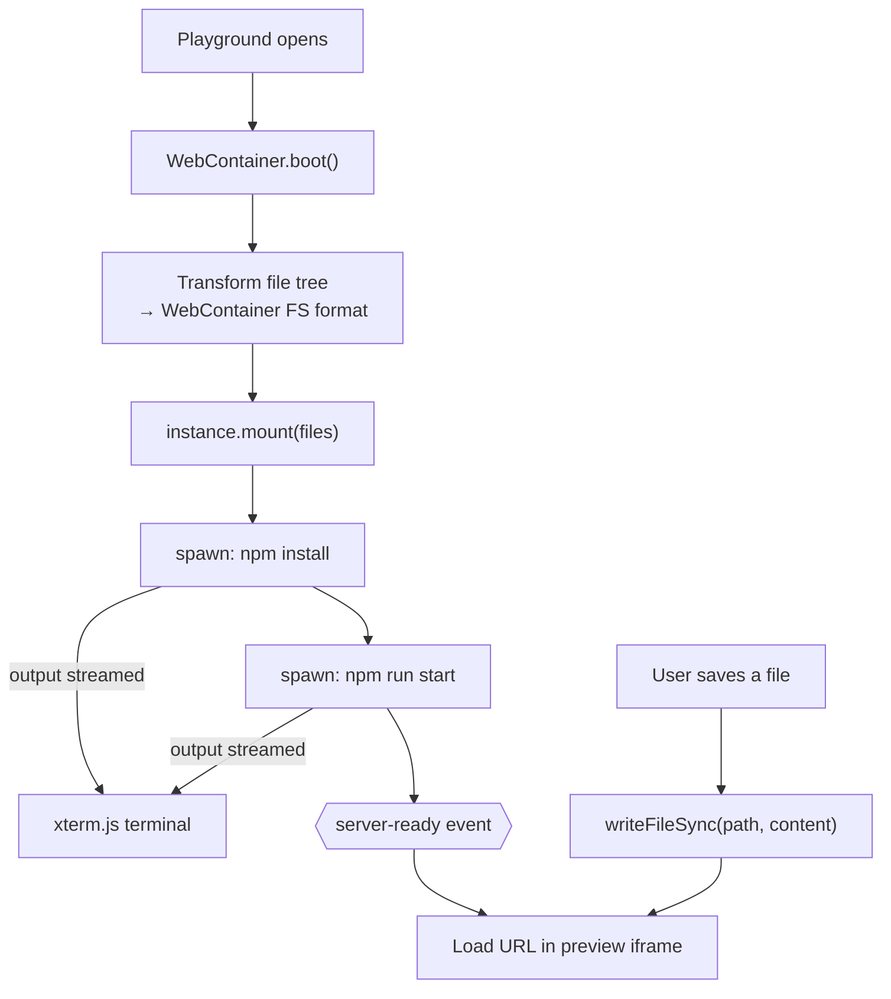
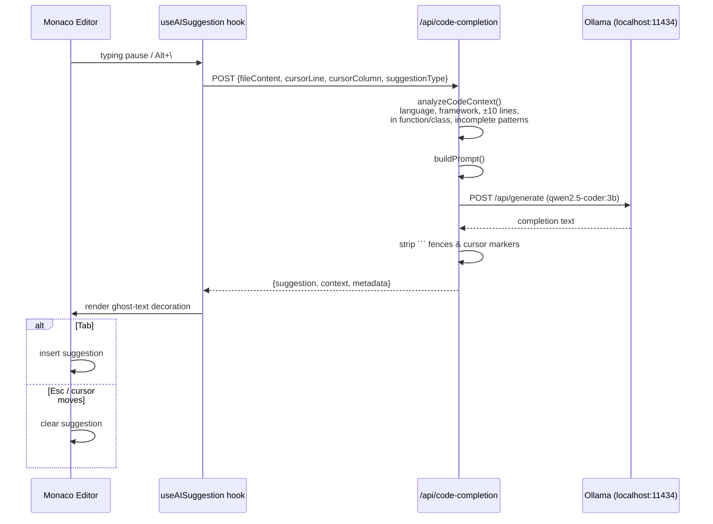
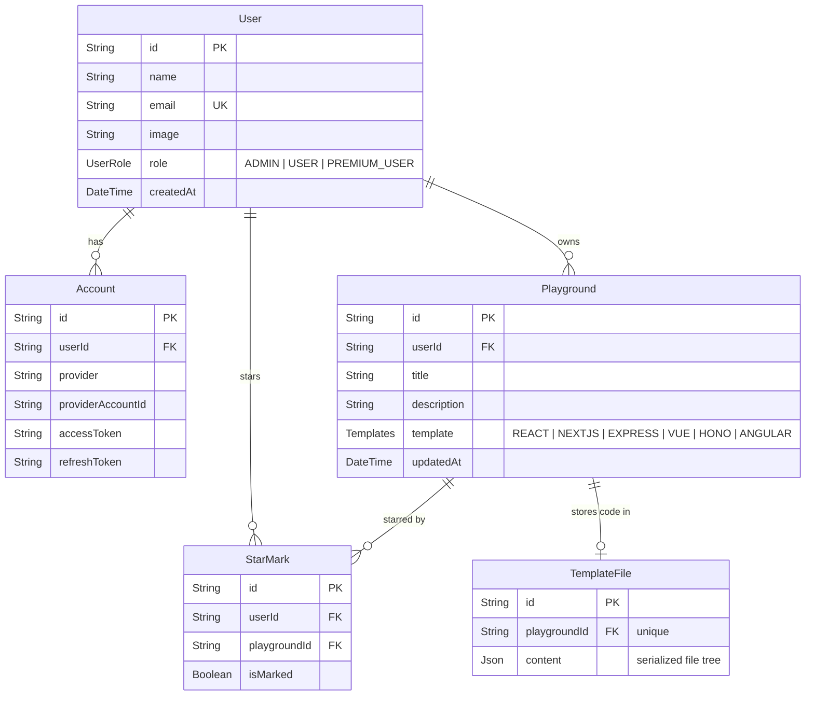

# CodeSphere — AI Code Editor

A browser-based code playground with an in-editor AI assistant. Pick a starter template (React, Next.js, Vue, Angular, Express, Hono), edit it in a VS Code–style Monaco editor, run it **entirely in the browser** with WebContainers, and get inline AI code completions from a locally hosted LLM.


---

## Table of Contents

- [Features](#features)
- [Tech Stack](#tech-stack)
- [Architecture](#architecture)
- [How It Works](#how-it-works)
  - [Authentication Flow](#authentication-flow)
  - [Creating & Opening a Playground](#creating--opening-a-playground)
  - [Running Code in the Browser](#running-code-in-the-browser)
  - [AI Code Completion](#ai-code-completion)
- [Data Model](#data-model)
- [Project Structure](#project-structure)
- [Getting Started](#getting-started)
- [Environment Variables](#environment-variables)
- [Keyboard Shortcuts](#keyboard-shortcuts)
- [Available Scripts](#available-scripts)
- [Roadmap](#roadmap)

---

## Features

- **OAuth sign-in** with GitHub and Google (Auth.js / NextAuth v5, JWT sessions)
- **Dashboard** to create, edit, duplicate, delete and star playgrounds
- **6 starter templates** — React (TS), Next.js, Vue, Angular, Express, Hono
- **Monaco editor** with tabs, file explorer, create/rename/delete files and folders
- **In-browser runtime** — `npm install` and `npm run start` execute inside a [WebContainer](https://webcontainers.io/), with a live preview iframe
- **Integrated terminal** powered by xterm.js
- **AI inline suggestions** — context-aware completions from a local [Ollama](https://ollama.com/) model (`qwen2.5-coder:3b`), shown as ghost text; Tab to accept, Esc to reject
- **Auto-persisted code** — the file tree is saved to MongoDB per playground
- **Light / dark theme** via `next-themes` and shadcn/ui components

---

## Tech Stack

| Layer | Technology |
|---|---|
| Framework | Next.js 16 (App Router), React 19, TypeScript |
| Styling / UI | Tailwind CSS 4, shadcn/ui, Radix UI, Base UI, lucide-react |
| Editor | Monaco Editor (`@monaco-editor/react`) |
| Runtime | `@webcontainer/api` (Node.js in the browser) |
| Terminal | xterm.js (+ fit, search, web-links addons) |
| State | Zustand, React hooks |
| Auth | Auth.js / NextAuth v5 (GitHub, Google) |
| Database | MongoDB via Prisma ORM |
| AI | Ollama running `qwen2.5-coder:3b` locally |

---

## Architecture



> **Note:** WebContainers need cross-origin isolation, so [next.config.ts](next.config.ts) sets `Cross-Origin-Opener-Policy: same-origin` and `Cross-Origin-Embedder-Policy: require-corp` on every route.

---

## How It Works

### Authentication Flow

All routes except `/api/auth/*` require a session. [proxy.ts](proxy.ts) (Next.js 16's replacement for `middleware.ts`) redirects anonymous users to `/auth/sign-in`, and signed-in users away from it.



### Creating & Opening a Playground



### Running Code in the Browser



### AI Code Completion

Suggestions are requested automatically after you pause typing, or on demand with <kbd>Alt</kbd>+<kbd>\\</kbd>. The server builds a context-rich prompt and sends it to Ollama.



---

## Data Model

Defined in [prisma/schema.prisma](prisma/schema.prisma) (MongoDB provider).



---

## Project Structure

```
codesphere-ai-code-editor/
├── app/                          # Next.js App Router
│   ├── (auth)/auth/sign-in/      # Sign-in page
│   ├── (root)/                   # Landing page
│   ├── dashboard/                # Project dashboard
│   ├── playground/[id]/          # Editor + preview + terminal
│   └── api/
│       ├── auth/[...nextauth]/   # NextAuth handlers
│       ├── code-completion/      # AI suggestion endpoint
│       └── template/[id]/        # Starter template → JSON
├── modules/                      # Feature modules
│   ├── auth/                     # Actions, sign-in form, user button
│   ├── dashboard/                # Project table, template picker, actions
│   ├── home/                     # Header / footer
│   ├── playground/               # Editor, explorer, dialogs, AI hook
│   └── webcontainers/            # WebContainer hook, preview, terminal
├── components/                   # shadcn/ui + providers
├── lib/                          # Prisma client, template paths, utils
├── prisma/schema.prisma          # Database schema
├── codesphere-starters/          # Starter project templates
├── auth.ts / auth.config.ts      # NextAuth configuration
├── proxy.ts                      # Route protection
└── routes.ts                     # Public / auth / protected route lists
```

The template → folder mapping lives in [lib/template.ts](lib/template.ts):

| Template | Folder |
|---|---|
| `REACT` | `codesphere-starters/react-ts` |
| `NEXTJS` | `codesphere-starters/nextjs` |
| `VUE` | `codesphere-starters/vue` |
| `ANGULAR` | `codesphere-starters/angular` |
| `EXPRESS` | `codesphere-starters/express-simple` |
| `HONO` | `codesphere-starters/hono-nodejs-starter` |

---

## Getting Started

### Prerequisites

- **Node.js** 20+
- **MongoDB** — a local instance or a MongoDB Atlas cluster (must be a replica set for Prisma)
- **Ollama** — for AI suggestions ([install](https://ollama.com/download))
- OAuth apps on **GitHub** and/or **Google**
- A Chromium-based browser or Firefox (WebContainers requirement)

### 1. Clone and install

```bash
git clone https://github.com/yash9359/CodeSphere-AI-Code-Editor.git
cd CodeSphere-AI-Code-Editor
npm install
```

### 2. Configure environment

Create a `.env` file in the project root (see [Environment Variables](#environment-variables)).

### 3. Set up the database

```bash
npx prisma generate
npx prisma db push
```

### 4. Start the AI model

```bash
ollama pull qwen2.5-coder:3b
ollama serve          # listens on http://localhost:11434
```

> The AI endpoint is optional — if Ollama is not running, the editor still works and the endpoint returns `// AI suggestion unavailable`.

### 5. Run the app

```bash
npm run dev
```

Open [http://localhost:3000](http://localhost:3000) and sign in.

---

## Environment Variables

| Variable | Description |
|---|---|
| `DATABASE_URL` | MongoDB connection string |
| `AUTH_SECRET` | Random secret for signing JWTs (`npx auth secret`) |
| `AUTH_GITHUB_ID` | GitHub OAuth app client ID |
| `AUTH_GITHUB_SECRET` | GitHub OAuth app client secret |
| `AUTH_GOOGLE_ID` | Google OAuth client ID |
| `AUTH_GOOGLE_SECRET` | Google OAuth client secret |

```env
DATABASE_URL="mongodb+srv://<user>:<password>@<cluster>/codesphere"
AUTH_SECRET="your-generated-secret"

AUTH_GITHUB_ID="..."
AUTH_GITHUB_SECRET="..."

AUTH_GOOGLE_ID="..."
AUTH_GOOGLE_SECRET="..."
```

OAuth callback URLs for local development:

- GitHub: `http://localhost:3000/api/auth/callback/github`
- Google: `http://localhost:3000/api/auth/callback/google`

---

## Keyboard Shortcuts

| Shortcut | Action |
|---|---|
| <kbd>Ctrl</kbd>/<kbd>⌘</kbd> + <kbd>S</kbd> | Save current file |
| <kbd>Ctrl</kbd> + <kbd>Shift</kbd> + <kbd>S</kbd> | Save all files |
| <kbd>Alt</kbd> + <kbd>\\</kbd> | Request an AI suggestion |
| <kbd>Tab</kbd> | Accept AI suggestion (while shown) |
| <kbd>Esc</kbd> | Reject AI suggestion |

---

## Available Scripts

| Command | Description |
|---|---|
| `npm run dev` | Start the development server |
| `npm run build` | Create a production build |
| `npm run start` | Run the production build |
| `npm run lint` | Run ESLint |

---

## Roadmap

- [ ] Copy template files when duplicating a playground
- [ ] Configurable AI provider / model (currently hard-coded to local Ollama)
- [ ] GitHub repository import (UI stub exists in `add-repo.tsx`)
- [ ] Role-based features for `PREMIUM_USER`
